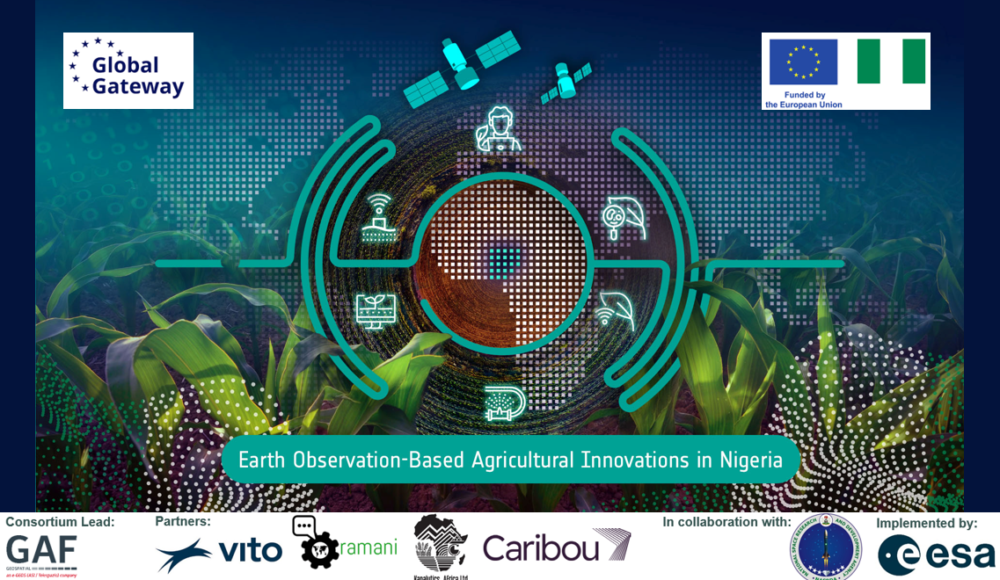

# ESA Nigeria InnoAgri Training Programme

  

## Course introduction

The **ESA Nigeria InnoAgri Training Programme** is an eight-week capacity development programme focused on the use of **Earth Observation (EO), Geographic Information Systems (GIS), in-situ and sensor data, Machine Learning (ML), Artificial Intelligence (AI), predictive modelling and cloud-based processing for climate-smart agricultural monitoring**.

The programme is implemented as part of the wider *Earth Observation-Based Agricultural Innovations in Nigeria* project. Its purpose is not only to transfer technical knowledge, but also to strengthen the long-term capacity of Nigerian institutions to independently use, adapt and further develop EO- and AI-based approaches for agricultural monitoring and decision support.

A central thread throughout the programme is the **Climate-Smart Information System (CSIS)** developed within the project. The training therefore progresses from a high-level introduction to EO and agricultural applications towards increasingly technical modules on GIS, data integration, crop monitoring, AI and predictive modelling. The final training weeks bring these elements together through the co-design and technical development of the CSIS.

## Intended audience

The programme is designed for participants from the project's primary institutional stakeholders:

- **National Space Research and Development Agency (NASRDA)**
- **Ministry of Agriculture**
- **Ministry Livestock**
- **Ministry of Water Resources Management**

The programme is expected to involve up to **50 participants**, but not every participant is expected to attend every module. The target audience ranges from policy analysts and agronomists to GIS/EO specialists, data scientists and technically oriented staff.

Participant selection for each module will take into account:

- the module objectives;
- the required prior knowledge and technical skills;
- the participant's professional role; and
- the expected contribution of the participant to future operational agricultural monitoring activities.

A capacity and skills assessment conducted at the start of the project showed substantial variation in existing knowledge and experience. The programme therefore follows a **tiered structure**, with Basic, Intermediate and Expert modules. The assessment also highlighted the need for particular attention to programming, ground sensors, crop modelling, database management, AI/deep learning, and the use of relevant Nigerian examples.

An important objective of the programme is **train-the-trainer capacity development**. In particular, NASRDA staff are expected to be able to reuse the materials and knowledge gained through the programme for future internal and national training activities.

## Scope and learning objectives

By the end of the programme, participants should have developed a stronger understanding of how EO and complementary data sources can support agricultural monitoring from national to field scale. Depending on the modules followed, participants will gain experience with:

- the principles and practical use of EO and GIS for agriculture;
- accessing, visualising and processing satellite and geospatial data;
- integrating EO with field observations, IoT sensors and other ancillary data;
- monitoring crop and vegetation conditions at regional and field scale;
- using cloud-based processing environments for EO analysis;
- applying machine-learning and deep-learning methods to EO data;
- using predictive and crop models for agricultural monitoring and early warning;
- translating user needs into operational EO-based applications; and
- understanding, co-developing and applying components of the project **Climate-Smart Information System (CSIS)**.

The course places particular emphasis on **agricultural and climate applications relevant to Nigeria**. Wherever possible, lectures, demonstrations and practical exercises will therefore use Nigerian examples, open datasets and use cases connected to the technical activities of the project.

## Course structure and delivery

The programme consists of **eight training weeks**. The first week provides a broad conceptual introduction to EO for agricultural monitoring and includes an initial assessment and co-creation of CSIS user requirements. The more technical modules are concentrated in 2027, with dedicated breaks between course blocks to allow participants to digest the material and work on assignments.

Training combines:

- **lectures and presentations** introducing concepts and methods;
- **live demonstrations** of relevant tools, datasets and processing workflows;
- **guided practical exercises**, primarily using GIS tools and Python/Jupyter notebooks;
- **discussion and co-creation sessions** connecting the technical content to institutional needs and the CSIS;
- **group assignments and independent exercises** to consolidate the material; and
- **course evaluation and feedback activities**.

The exact balance between theory and practice varies by module. Basic modules focus on building a shared conceptual and practical foundation, while Intermediate and Expert modules increasingly require participants to work with data, code, analytical workflows and application-development concepts.

## Training schedule

| Week | Timing | Level | Module / focus | Lead |
|---|---|---|---|---|
| 1 | 16-20 November 2026 | Basic | **Module 1 - Introduction to EO and Applications for Agriculture**; user-requirements assessment and initial CSIS co-creation | VITO, with RAMANI and NASRDA |
| 2 | March 2027 | Basic / Intermediate | **Module 2 - GIS and Geospatial Data Fundamentals** + **Module 4 - Low Resolution Agricultural Monitoring** | KAnalytics |
| 3 | March 2027 | Basic / Intermediate | **Module 3 - Integration of EO and In-Situ Data** + **Module 5 - High Resolution Agricultural Monitoring** | RAMANI, VITO |
| 4 | March 2027 | Intermediate | **Module 5 continued** + CSIS co-creation | VITO, KAnalytics |
| 5 | April 2027 | Expert | **Module 6 - Deep Learning and Advanced AI Applications** | VITO, KAnalytics |
| 6 | April 2027 | Expert | **Module 7 - Predictive Crop Modelling** | RAMANI, KAnalytics |
| 7 | April 2027 | Expert | **Module 8 - CSIS Co-creation Week** | RAMANI |
| 8 | May 2027 | Expert | **Module 8 - CSIS Co-creation Week** | RAMANI |

> Detailed dates for Weeks 2-8 will be confirmed with NASRDA and the participating institutions.

## Course levels and prerequisites

The programme uses three course levels:

### Basic

A gentle introduction to key concepts, demonstrations and hands-on experiences. These modules establish the conceptual and technical foundation required for later modules and are particularly suitable for participants with limited prior experience in EO and GIS.

### Intermediate

A more technical level aimed at developing a genuine understanding of EO-based agricultural monitoring methods and the practical skills required to implement basic analytical applications independently.

### Expert

Advanced modules focusing on innovative analytical methods, system development and the technical skills required to develop, operate and maintain agricultural monitoring services. These modules are mainly targeted at technical experts from NASRDA who may contribute directly to the future operation and further development of the CSIS.

Specific prerequisites will be communicated for each module. For the more advanced modules, familiarity with **Python or R**, basic programming concepts and **Jupyter notebooks** is expected.

## Course modules

### Module 1 - Introduction to EO and Applications for Agriculture

**Level:** Basic  
**Lead:** VITO  
**Additional teachers:** RAMANI, NASRDA  
**Target audience:** Ministry of Agriculture, Ministry of Livestock, and relevant NASRDA staff

A high-level thematic introduction to Earth Observation for agriculture. The module introduces optical, radar, thermal and LiDAR observations; discusses the strengths and limitations of satellite and UAV data; provides an overview of agricultural EO applications; reviews existing NASRDA activities and assets; and starts the process of translating stakeholder needs into CSIS services.

[Open Module 1](module-01/index.md)

### Module 2 - GIS and Geospatial Data Fundamentals

**Level:** Basic  
**Lead:** KAnalytics

A practical introduction to manipulating geospatial data using GIS and introductory programming. Topics include raster and vector data, coordinate systems and projections, map algebra, map creation, EO data-access portals, data ethics and open-access policies, and basic EO processing in Python.

### Module 3 - EO Data Fusion with In-Situ and Sensor Data

**Level:** Basic  
**Lead:** RAMANI  
**Additional teacher:** KAnalytics

An introduction to the collection, management and integration of in-situ and sensor data with EO. Topics include data fusion, geostatistics and interpolation, basic examples combining weather-station and EO data, introductory machine learning, and an introduction to STAC catalogues.

### Module 4 - Low Resolution Crop Monitoring and Early Warning

**Level:** Intermediate  
**Lead:** KAnalytics

A conceptual and practical introduction to regional-scale crop and vegetation monitoring. Topics include temporal anomalies and drought monitoring, crop canopy variables, phenology, biomass productivity, evapotranspiration, soil moisture, water productivity, advanced time-series analysis and crop suitability assessment.

### Module 5 - High Resolution Crop Mapping and Monitoring

**Level:** Intermediate  
**Lead:** VITO

A field- and parcel-scale agricultural monitoring module focused on high-resolution EO data. Topics include EO data access through the Copernicus Data Space Ecosystem and openEO, cropland and crop-type mapping, precision agriculture, parcel-level indicators, UAV applications and cloud computing.

### Module 6 - Deep Learning and Advanced AI Applications

**Level:** Expert  
**Lead:** VITO  
**Additional teachers:** KAnalytics, RAMANI

An introduction to advanced AI for EO and agriculture, covering traditional machine-learning recap, deep-learning architectures, geospatial foundation models, large language models, agentic AI, responsible AI, and possible integration of these capabilities into the CSIS.

### Module 7 - Predictive Modelling for Agricultural Monitoring

**Level:** Expert  
**Lead:** RAMANI  
**Additional teacher:** KAnalytics

An introduction to crop models and predictive approaches for agricultural monitoring. Topics include crop-growth modelling, integration of crop models with EO, data assimilation, climate modelling, drought forecasting and co-development of CSIS prototypes.

### Module 8 - Climate-Smart Agricultural Information System

**Level:** Expert  
**Lead:** RAMANI

The final module focuses on the thematic and technical implementation of the CSIS. Topics include STAC-based data management, back-end architecture, running CSIS prototypes, front-end development, integration with LLM services and final co-creation of the system with the future NASRDA technical team.

## Learning progression

The programme is deliberately structured as a progression from **awareness and fundamentals to operational application development**.

- **Week 1** establishes a common understanding of EO-based agricultural monitoring and uses this shared understanding to refine user needs and expectations for the CSIS.
- **Weeks 2-4** strengthen practical geospatial, EO and data-integration skills and cover agricultural monitoring at regional and field scale.
- **Weeks 5-6** introduce advanced AI and predictive modelling techniques.
- **Weeks 7-8** bring the previous components together through focused CSIS co-creation and system development.

This structure supports differentiated participation: staff requiring a general understanding of EO-based agricultural monitoring can focus on the Basic and Intermediate modules, while participants with stronger technical and programming backgrounds can continue into the Expert modules.

## Practical environment and training materials

The programme follows an **open and reusable training approach**. Course materials are distributed through this GitHub repository, while the companion **GitHub Pages Training Hub** provides a participant-friendly entry point to all training resources.

Each module page will provide access to:

- lecture slides and presentations;
- practical exercise instructions;
- Jupyter notebooks and scripts;
- datasets or links to external datasets;
- assignments;
- relevant surveys and results;
- supplementary documentation and readings; and
- outputs generated during co-creation exercises.

Theoretical content will primarily be provided as presentations, while practical components will use **GIS exercises, Python/Jupyter notebooks and open-access datasets**. Where appropriate, exercises will make use of the **Copernicus Data Space Ecosystem (CDSE)** and cloud-based processing environments.

The training materials are intended to remain available after the formal training programme so that participants and future trainers can revisit, reuse and adapt them.

## Assignments, evaluation and certification

Assignments and evaluation activities will be adapted to the content of each module and may include:

- practical GIS or Jupyter-notebook exercises;
- short presentations;
- quizzes;
- group assignments;
- CSIS co-creation exercises; and
- short reflections on how the acquired knowledge can be applied in the participant's professional context.

Participants will also be invited to provide feedback after each module on the relevance of the material, course content, balance between theory and practice, and teaching effectiveness.

Participants who successfully complete the applicable course requirements will receive a **course certificate**.

## Long-term capacity development

The training programme is designed as more than a one-off series of courses. It is closely linked to the establishment of the EO Training Lab at NASRDA, the co-development of the CSIS, and the wider objective of strengthening Nigeria's capacity to use EO, AI and complementary data sources for climate-smart agricultural monitoring.

By combining open training materials, practical skills development, train-the-trainer activities and direct links to operational project applications, the programme aims to create a foundation for **continued institutional learning, reuse of the training materials and autonomous further development of EO-based agricultural services beyond the lifetime of the project**.
